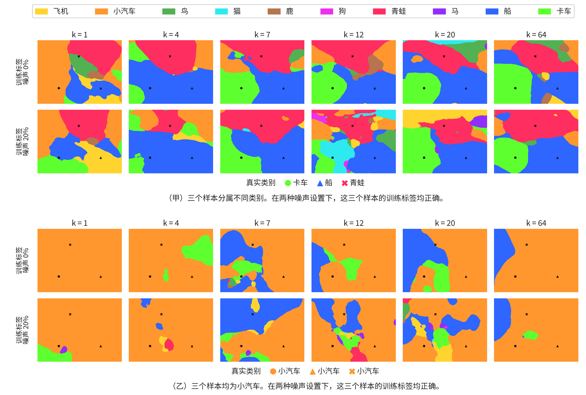

# 单卡复现神经网络的决策边界与双下降

在 CIFAR-10 上，增大网络宽度时，测试错误率、决策区域的形状和训练样本到边界的距离会怎样变化？本仓库复现了 Somepalli 等人（CVPR 2022）的部分实验，提供训练与评估代码、逐项测量、中文图表和 CPU 重绘入口。图号以 [arXiv 第一版](https://arxiv.org/abs/2203.08124v1) 为准，模型实现基于作者的 [dbViz](https://github.com/somepago/dbViz/tree/aeea84c42a32efafebbb29c3d944204aa74963cf)。

[四页中文 PDF · 图 7 展示本次峰值宽度 12](figures/figures-500epochs-k12-zh.pdf) · [按论文宽度选列的四页版](figures/figures-500epochs-zh.pdf) · [原始测量与字段说明](data/README.md) · [从头训练与评估](docs/training.md)

[](figures/fig07-k12.pdf)

## 用 CPU 重绘四张图

在仓库根目录运行以下命令。推荐使用 Python 3.11。第一次安装 Python 依赖后，校验和绘图均可离线运行。中文绘图字体已随仓库提供。

```sh
python -m pip install -r requirements-plot.txt
python data/verify.py
python scripts/redraw.py
python scripts/figure7_peak.py --panels data/figure7-k12-500-panels.zip --curves data/curves.csv --out build/fig7-k12
```

`scripts/redraw.py` 在 `build/figures/` 生成按论文宽度选列的四张单页 PDF 和合订本，支持 `--results` 指定数据目录、`--out` 指定输出目录及 `--font` 指定中文字体。最后一条命令读取额外的宽度 12 面板，在 `build/fig7-k12/` 生成上方展示的图 7 和相应的四页合订本。

## 这次实验观察到了什么

下表是带 20% 训练标签噪声、训练 500 轮时的三个**实测宽度**。在所测的 11 个宽度中，随机平面被切分得最碎、错标样本离边界最近，都出现在宽度 12。这组宽度实验固定初始化种子为 1，峰谷位置描述的是本次运行。

| 网络宽度 | 图 10 · 随机训练三元组的平均连通区域数 | 图 12 · 错标样本的类别区域边距中位数 |
| ---: | ---: | ---: |
| 4 | 8.633 | 41.71 |
| 12 | 18.205 | 19.46 |
| 64 | 9.830 | 26.36 |

图 10 的每个点汇总 1,000 个平面，每个平面取 50 × 50 个网格点。图 12 的每组采样 5,000 次，每次以 10 个有效方向为目标。查看[全部实测点](data/curves.csv)或[与论文原图读数的对照](comparisons/README.md)。

## 图表与实验范围

| 图 | 实验设置 | 已保存的结果 |
| --- | --- | --- |
| [1 · 自然图像](figures/fig01-solid.png) | 全连接网络、ViT、WideResNet；两个初始化种子，同一组三张图像 | 6 个决策区域面板 |
| [2 · 打乱像素的图像](figures/fig02-solid.png) | ViT、DenseNet、ResNet；三组三元组，保留每个像素的 RGB 分量 | 9 个面板及[逐点预测网格](architecture-results/figure2/figure2_g500.npz) |
| [3 · 不同模型架构](figures/fig03-solid.png) | 七种架构、三个初始化种子 | 21 个面板及 [ResNet-18 双种子一致率记录](architecture-results/README.md) |
| [6 · 测试错误率](figures/fig06.pdf) | 11 个宽度，各用 0% 和 20% 标签噪声训练 | 22 个实测点 |
| [7 · 决策区域](figures/fig07-k12.pdf) | 宽度 1、4、7、12、20、64；两种噪声，两组三元组 | 24 个 500 × 500 类别网格，纯色表示预测类别；[第四列取宽度 10 的归档版](figures/fig07.pdf) |
| [10 · 决策区域碎片化](figures/fig10.pdf) | 随机训练三元组、同类且正确标注的三元组 | 44 个均值及 44,000 条逐平面记录 |
| [12 · 类别区域边距](figures/fig12.pdf) | 按噪声水平、标签是否被改写分组 | 44 个中位数及 220,000 条逐样本记录 |

架构实验的训练预算为每个模型 100 轮。宽度实验采用每个模型 500 轮，论文第一版第 6 页描述的宽度实验采用 4,000 轮。图 6、10、12 实测的宽度为 1、2、4、6、7、8、10、12、20、40、64。连线连接相邻的实测宽度。图 7 的纯色版本保留了模型在平面上每个网格点的类别预测，其底层数据另外保存了置信度。

图 7 的第四列来自两份宽度 12 的第 500 轮权重。图中两组三元组的位置与另外五列相同，可以逐行比较区域形状。[宽度 12 的四个原始面板](data/figure7-k12-500-panels.zip) · [核验记录与重绘说明](docs/figure7-k12.md)

## 代码与来源

本仓库新增的代码采用 [Apache License 2.0](LICENSE)。上游模型、中文字体和论文对照读数的来源分别列在[来源与许可说明](docs/sources.md)中。CIFAR-10 由训练入口按需获取；预计算结果已可直接浏览和核对。
