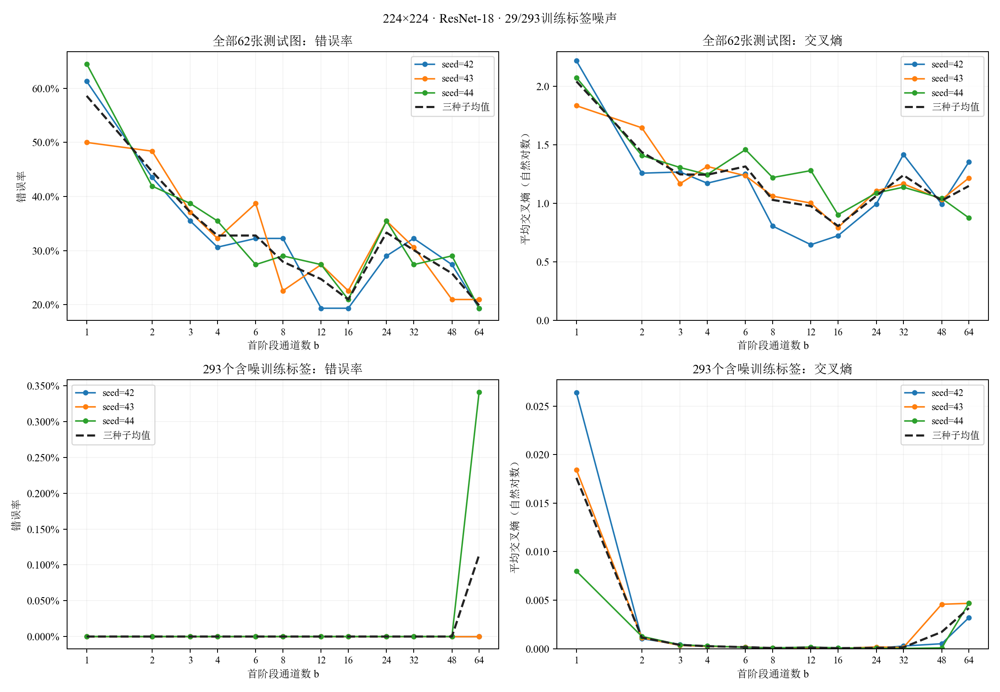
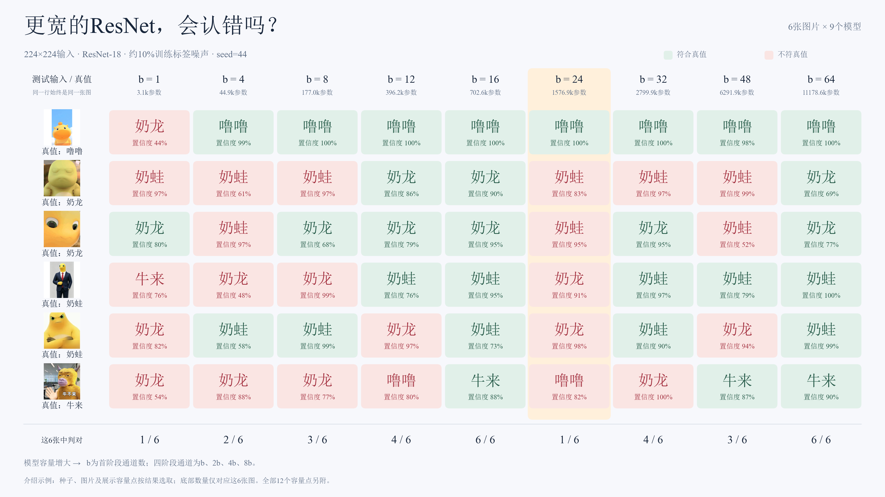
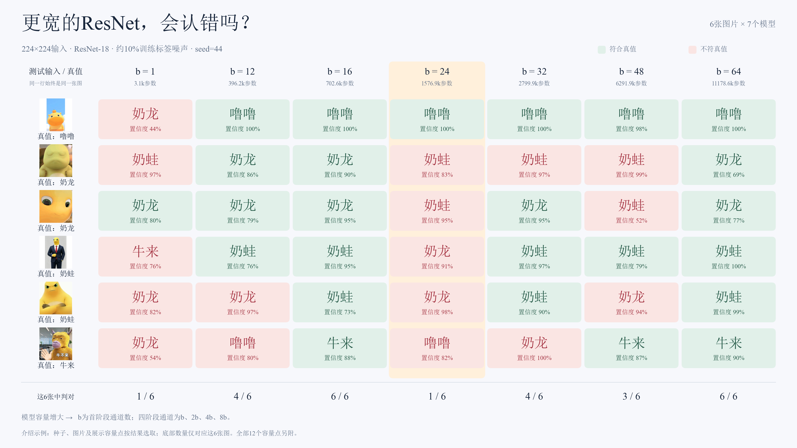
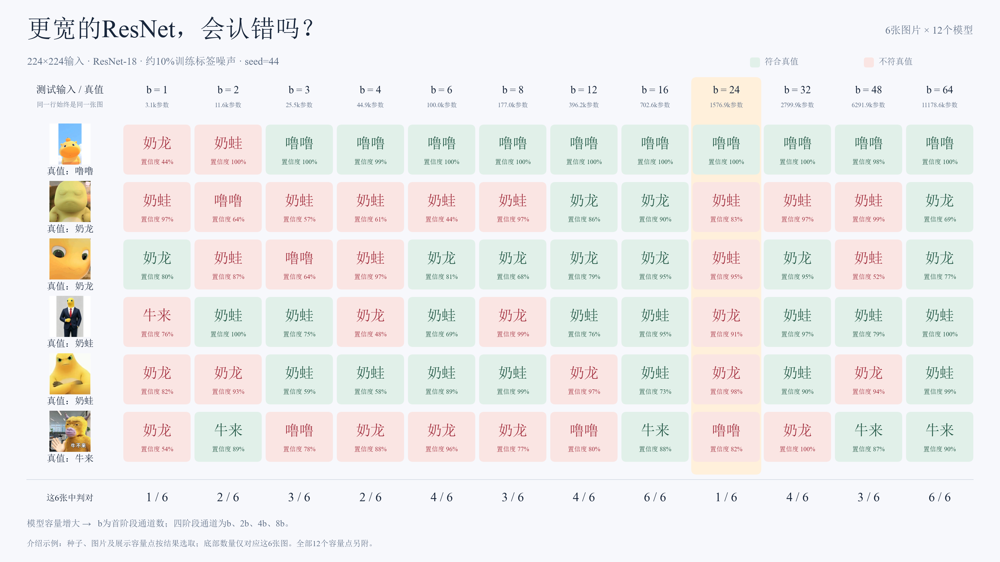

# ResNet-18 / 224×224 / 10%训练标签噪声

沿用417张图片及训练293/验证62/测试62的划分。输入与ViT224完全一致：保持长宽比缩放、居中补白到224×224，训练集通道均值/标准差归一化。只在训练中加入29/293（9.90%）错标，验证和测试保持人工标签。29张为原59张错标的分层子集，不改原始图片或清单标签。

从零训练ResNet-18，标准7×7步长2卷积和最大池化；四阶段各2个BasicBlock，通道分别b/2b/4b/8b。b=64与torchvision标准ResNet18四分类结构及计算完全一致。扫描b=1,2,3,4,6,8,12,16,24,32,48,64，种子42/43/44。Adam，学习率0.001余弦降至0.00001，400轮，batch64，无增强、dropout或权重衰减，使用末轮权重。测试错误率和自然对数交叉熵都报告；模型替换与降低噪声同时进行，因此不能单独归因于其中一个因素。

Mac本机：`python3 run.py --device mps`。

NVIDIA：先在CUDA版PyTorch环境运行 `python -m pip install numpy pandas matplotlib Pillow`，再运行 `python run.py --device cuda`。自动选择设备：`python run.py`。不需要重新下载数据或预训练权重。

进度见training.log与每个runs子目录的history.csv；仅已完成的模型可续跑，中断模型从头训练。全流程结束生成pipeline_completed.json。run.py先核验输入，自动做当前设备的速度检查，再执行固定网格及报告。

## 结果

已完成36/36组。完整曲线同时展示全部测试图的错误率、交叉熵及含噪训练标签的拟合程度。模型族变化或标签噪声降低均不保证出现双下降，结论以完整曲线为准。

图片对照按结果筛选，仅作介绍示例；底部计数只针对选中6张图片。

