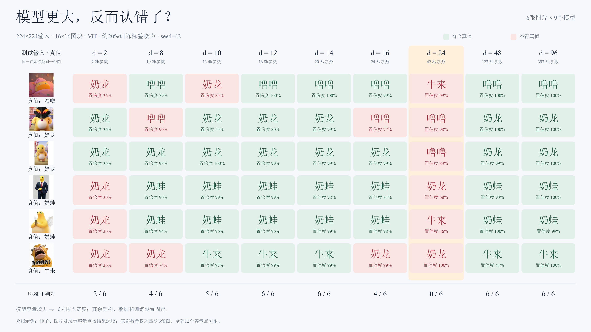
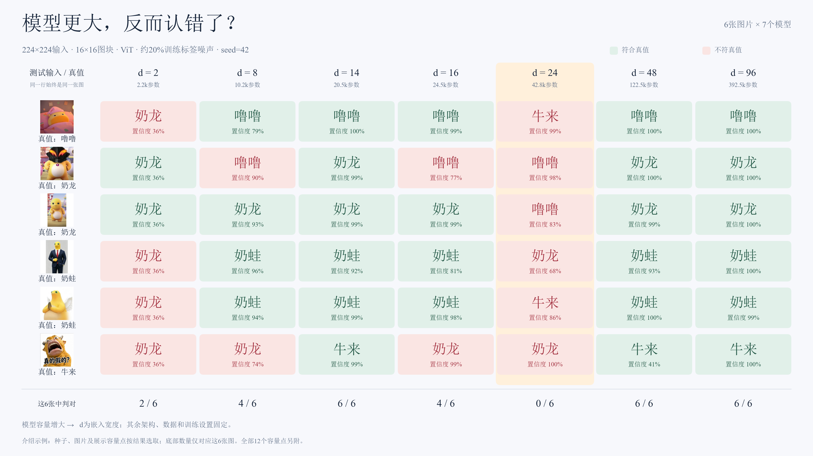
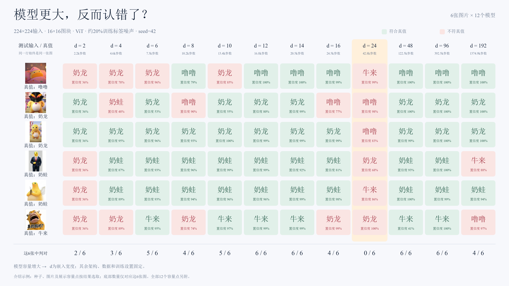
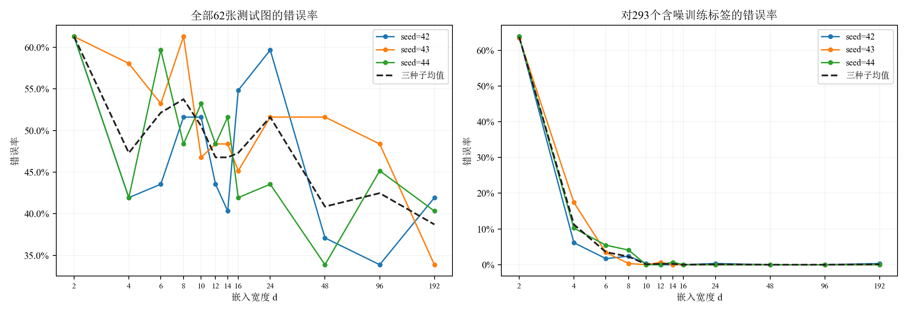
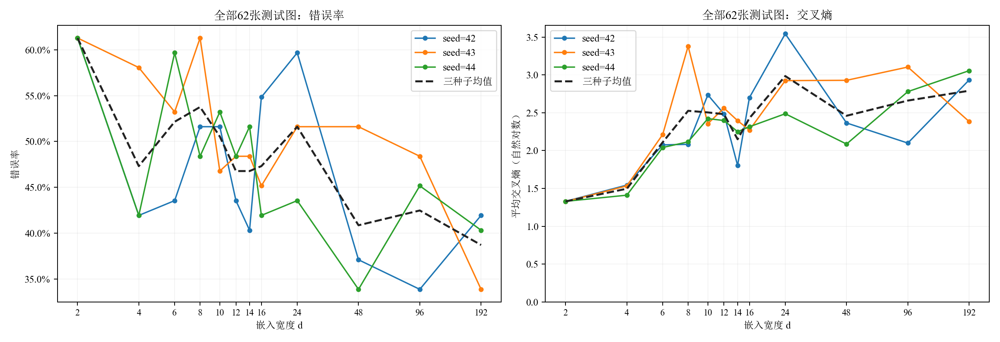
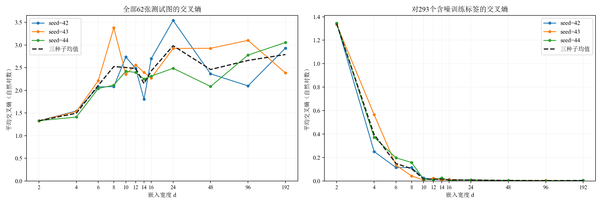

# 224×224输入的ViT重跑结果

完成36/36组训练。12个宽度×3个种子，训练集含59/293个固定错误标签；验证/测试各62张且标签正确。

输入：RGB，保持长宽比双线性缩放并居中补白到224×224，使用训练集计算的通道均值/标准差。三个集合均使用同一确定性预处理，不做数据增强。16×16图块，每块768维像素，196个图块加CLS后共197个token。

模型：从零训练的4层、2头SmallViT，MLP宽度2d；只扫描d。Adam，学习率0.001余弦降至0.00001，400轮，batch=64，无权重衰减或dropout，使用末轮权重。采用224/16输入规格，不等同于训练86M参数的ViT-B/16。

按要求选择seed=42的介绍示例。全部测试错误率在d=14、24、96分别为40.32%、59.68%、33.87%。上升19.35个百分点，随后下降25.81个百分点。

种子、图片和展示列按结果选择；6张图覆盖四个类别，优先选早期正确、中间错误、后期恢复的图片，再兼顾预测稳定性及角色是否清晰易认。图片展示模型实际接收的224×224补白输入。底部计数只对应这6张，不是整个测试集准确率。完整候选排名和全部预测均保留。

所选中间模型的含噪训练错误率为0.34%；没有将其直接称为精确插值阈值，也未测量决策边界或验证论文机制。

| d | 参数量 | 训练错误/293 | 全部测试错误/62 | 展示图判对/6 |
|---:|---:|---:|---:|---:|
|2|2,166|187|38|2|
|4|4,584|18|26|3|
|6|7,258|5|27|5|
|8|10,188|7|32|4|
|10|13,374|1|32|5|
|12|16,816|0|27|6|
|14|20,514|0|25|6|
|16|24,468|0|34|4|
|24|42,844|1|37|0|
|48|122,548|0|23|6|
|96|392,548|0|21|6|
|192|1,374,916|1|26|4|

完成整轮后，summary.csv另存每个宽度的三种子均值、标准差及完全拟合的运行数。

复现：在experiment目录执行 `python3 run_vit224.py`。旧32px训练产物已按要求清理；原分割/噪声清单保留以核验本轮224px输入。

## 测试损失复核

从全部36组末轮保存的logits重新计算自然对数交叉熵（每组完整62张测试图），未重训或重选图片；训练、测试损失均与原始results.csv一致（容差1e-5）。

测试交叉熵没有比错误率呈现更清晰、稳定的双下降：三种子均值在d=2、24、48、96、192分别为1.328、2.984、2.459、2.660、2.790，缺少最初下降，后段也有波动。seed=42在d=14→24→96仍有1.803→3.542→2.099的局部升降，但这不足以说明跨种子稳定的双下降。原6张图片对照适合展示选定图片的预测反复，不应将其称为完整测试集双下降的验证。

错误率只看最终类别；交叉熵还惩罚真实类别概率低、特别是自信的误判。因此较宽模型可以错误率更低、交叉熵更高。

逐组数据：loss_results.csv；三种子汇总：loss_summary.csv；逐图片损失：test_image_losses.csv；复核：loss_validation.json。

复现：在experiment目录执行 `python3 analyze_vit224_losses.py`。
